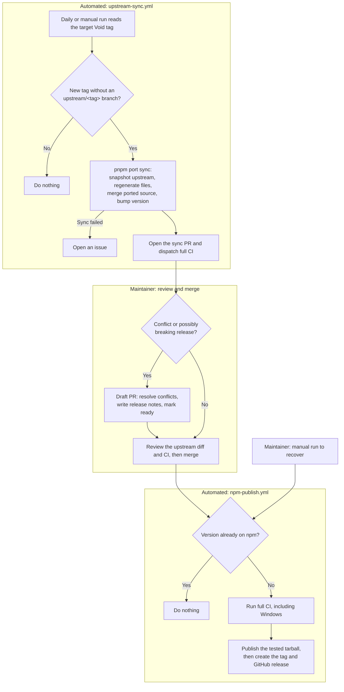

# void-preact design

`void-preact` is a [Preact](https://preactjs.com) adapter for [Void](https://void.cloud), ported from `@void/react`. A Void app switches to it by changing one plugin and its imports. The rule that shapes this repo is that it follows `@void/react`, in API and in tests, at every Void release.

## Repo layout mirrors the upstream monorepo

```
docs/DESIGN.md             adapter design and support contract
docs/API.md                API differences from @void/react
docs/CONTRIBUTING.md       development commands
upstream.json              pinned tag and SHA
upstream/.node-version     pinned upstream Node version
.node-version              generated Node version
upstream/                  verbatim snapshot at that tag, never edited
tools/port/config.ts       every recorded difference from packages/react
tools/port/run.ts          sync, generate, check, report
tools/port/overlay/        hand-owned files that replace generated ones
tools/ci/                 package and CI checks
packages/preact/src/       the adapter, same file names as packages/react/src
packages/preact/test/unit, integration, fixtures   generated from upstream
packages/preact/test/preact/                       hand-written tests
test/*.ts                 generated shared contract and helpers
test/comparison/          installed React and Preact comparison
test/comparison/app/      canonical comparison app
test/fixtures/react-stub/  react and react-dom names for upstream tests
test/fixtures/md-host/     published Markdown plugin host
playground/preact-pages/   generated from playground/react-pages
```

The tree has the shape of the upstream one, so upstream test files keep their relative imports and need few edits. Moving `packages/preact` into a Void fork later is a directory copy.

## How a difference from upstream is recorded

`tools/port/config.ts` is the single place that says how this repo differs.

| Field | Meaning | What enforces it |
| --- | --- | --- |
| `rewrites` | Renames applied to every generated file | `check` compares generated files byte for byte |
| `mechanical` | Source files equal to upstream after `sourceRewrites` | `check` fails on any drift |
| `ported` | Hand-written source files | `sync` three-way merges upstream's change; conflicts make the PR a draft |
| `testRewrites` | An edit that keeps an upstream assertion meaningful, with a reason | Generation fails if the text is gone upstream |
| `divergences` | An upstream test this adapter skips, with a reason | Generation fails if the title is gone upstream |
| `dropped` | Generated paths this repo removes | Listed for review |
| `preserved` | Hand-owned directories inside generated roots | Neither generation nor stale-file cleanup writes there |

Generation removes stale nonignored files within its owned output directories, and `check` rejects them before regeneration. Git-ignored caches and build artifacts are excluded from cleanup.

Upstream source that is in neither `mechanical` nor `ported` fails `check`, so a new upstream file cannot be missed.

## How tests stay close to upstream

Upstream tests import `react` directly. `test/fixtures/react-stub` holds workspace packages named `react` and `react-dom` that re-export `preact/compat`, so the tests run as written, including those that start their own Vite server. The stub's `act` waits for pending work the way React's does. The stubs are dev-only and are never published. Playground pages reach Preact through the alias that `@preact/preset-vite` installs.

`packages/preact/test/preact/api-surface.test.ts` compares the exports of `runtime/index.ts` with the upstream file. Its allowed additions are `Suspense`, `use`, and `useFormStatus`, to expose Suspense and use from preact/compat and the adapter’s own useFormStatus.

## Runtime differences from React

These are the choices forced by what Preact 11 does not have.

**Navigation has no transitions.** `useTransition` in `preact/compat` returns `[false, startTransition]`, and `startTransition` runs its callback synchronously. So a resource gains a `result` field, set when its shell settles, and only a resource with a result renders. The reducer in `pages-client.ts` is otherwise upstream's. `NavigationFallback` renders when the current resource has no result and a visit is pending.

**A page that suspends with no boundary of its own shows nothing.** React holds the old page during a transition. Preact's root `Suspense` shows its `null` fallback. Deferred props under the documented `<Suspense>` pattern are unaffected. Navigating away while that root remains suspended replaces only the parked boundary, so the destination can render before the old promise resolves. This resets shared layout state in Preact; React retains it. Normal navigation keeps its boundary and layout state. The comparison records cancellation recovery as a shared case and layout-state retention as a separate observed difference.

**Form actions are provided by the adapter.** React 19 accepts a function as `<form action>`, and `@void/react` is built on it. `runtime/form-action.tsx` installs an `options.vnode` hook that swaps such a `form` for a component that calls the function with `FormData` and provides `useFormStatus`. `form.tsx` stays the upstream shape. React's automatic reset of uncontrolled fields after an action is not reproduced, because `form.reset()` would blank controlled inputs that Preact does not re-diff.

**`useForm` has its own pending state.** `useActionState` does not exist in Preact. A queue keeps submits sequential, as React does, and a thrown error is rethrown in render to reach the nearest error boundary.

**Server rendering uses the `preact-render-to-string` stream.** It writes the shell as one first chunk, then emits `<div hidden>` for suspended trees. The first chunk arrives before that div, so upstream's `readDeferredShell` cuts at the marker unchanged. A render error rejects the first read, which `readShell` awaits so the caller can serve its error page.

**The engine starts before hydration.** Preact renders synchronously, so `engine.start()` moves ahead of `hydrate()`. React scheduled its render for later, which gave the same order.

**HMR needs no preamble.** Prefresh injects its setup in a module transform, so the React Refresh preamble is gone. The Worker optimizer pre-includes `preact/devtools`, which the preset injects after scanning. Discovering it during SSR would reload the Worker and mix hooks and renderer instances.

## Void core selects adapters by plugin name

`@void/md` (`packages/md/src/plugin.ts`) and the auth client path (`packages/void/src/plugin-routing.ts`) read a fixed list of plugin names. `plugin.ts` adds a marker plugin named `void-react:pages` and aliases `@void/react` to `void-preact`, so the React code they select runs on Preact. Both package names are excluded from dependency optimization to preserve shared contexts. The browser optimizer pre-includes `void > better-auth/react` because Void selects that auth adapter after scanning. The marker depends on upstream internals, and the upstream `md-layout-frontmatter` and `island-css-build` tests are what catch it breaking. `void init` still does not offer Preact.

## Preact behavior this adapter works around

`runtime/preact-suspense-adapter.ts` owns every private Preact access. The internal `SettledSuspense` facade and the generated island bootstrap expose no private hooks. This dependency is accepted with maintainer-owned update verification; its removal is not a prerequisite for using this adapter.

- Preact runs effects above a suspended child at once, and sets no boundary state during hydration. `SettledSuspense` tracks the root boundary so navigation commits and `data-hydrated` wait for its content, as React's commit does.
- On resume, Preact hydrates a `$s` range as if it held streamed content. A deferred shell is cut before any streamed content, so the range holds the fallback, and the real content would keep the fallback element's attributes. The adapter empties the range first on deferred pages.

## Automation

Automation carries each Void release as far as a pull request. A maintainer decides what merges, and merging a version change publishes it.



Upstream sync runs daily at 06:00 JST (21:00 UTC), or manually. It opens an update PR and dispatches the full CI, including the React/Preact comparison. Review and merge remain maintainer actions. GitHub must allow Actions to create pull requests.

The npm publish workflow runs when a merge to `main` changes the package version to one npm does not have, or when dispatched manually. It calls the shared CI with Windows enabled, then publishes the exact tested tarball from that same workflow run. It creates a version tag and GitHub release with compatibility details and evidence. npm trusted publishing and the GitHub `npm` environment must be configured first; see [release setup and procedure](#releasing). Reviewing and merging a version change is therefore the decision to publish.

| Workflow | Job | What it proves |
| --- | --- | --- |
| `ci.yml` | `port` | Generated files, mechanical source, and classification match the pinned snapshot |
| `ci.yml` | `checks` | Build, strict typecheck including all adapter tests, upstream and own unit tests on Linux and Windows |
| `ci.yml` | `integration` | The upstream shared contract against the playground, in Chromium, in dev and preview on Linux and Windows |
| `ci.yml` | `packed-consumer` | The packed tarball builds and server-renders in a fresh app outside the workspace |
| `ci.yml` | `comparison` | Shared behavioral and private-Suspense maintenance cases against real installed React and packed Preact, in dev and preview |
| `upstream-sync.yml` | `sync` | Daily, opens a PR for a new Void release with the upstream diff and ported files to review, then dispatches full CI |
| `ci.yml` | `required` | Stable `CI required` check aggregating every selected job |
| `npm-publish.yml` | `verify`, `publish` | Manual release from main; reusable CI with Windows, exact tested tarball publication, version tag and release evidence |

Normal pull requests run Linux checks. PRs labeled `test: windows` and main pushes also run Windows build, typecheck, unit and integration checks. Adding or removing a label reruns CI; subsequent PR commits retain the label choice. Manual CI runs expose a `windows` option, disabled by default. Packed-consumer and comparison tests run on Linux with Chromium. Upstream-sync dispatches use the default Linux checks before review; their merged main commit receives Windows verification before publication.

### Branch ruleset

In Settings → Rules → Rulesets → main, replace the seven individual required status checks with **CI required**, from **GitHub Actions**. Keep strict up-to-date checking and the other existing protections. The aggregate runs even after a dependency fails or is cancelled, and fails unless all selected jobs succeed. A labeled PR therefore still requires Windows success. Do not require optional Windows matrix entries individually, or ordinary PRs will wait for checks that were never created. Do not require the npm publish workflow for merging.

Wait for `CI required` to appear in a CI run before selecting it in the ruleset. The repository ruleset is maintained in GitHub settings, separately from these workflow files.

## Versioning

`void-preact` has its own semver and peers on one exact `void` version, as `@void/react` does, because it imports `void/pages-client` and other adapter-facing entries that change between releases.

## Alternatives rejected

**Alias `react` to `preact/compat` over the published `@void/react`.** Measured, the build fails because `useActionState` and `renderToReadableStream` are not exported.

**Fork the void repo.** A merge would not carry `packages/react` changes into `packages/preact`, so the sync tool is needed anyway, and the fork carries the platform code and its CI.

**Git submodule for upstream.** A sync PR would show a SHA bump instead of the upstream diff, which is the thing a reviewer needs.

**Hand-copied tests.** They drift silently, and nothing records why a test differs.

## Updating Void

Use Node from `.node-version` and the package manager in `package.json`. Install with `pnpm install --frozen-lockfile`.

The daily sync workflow opens one branch per upstream tag and closes older open sync PRs without deleting their branches. Sync also applies `mechanical` source, three-way merges `ported` source, bumps the patch version, and updates the README row, so a clean sync only needs review and merge. A clean merge does not prove the code is correct under Preact: review the listed files against upstream.

A conflict, or an upstream release that looks breaking, makes the PR a draft. Looking breaking means a major version, or release notes that mention a breaking change or `void migrate`; this is a heuristic, so add the `breaking` label by hand if it misses one. A breaking sync bumps the minor version instead. Write the change and its migration steps under `## Release notes` in the PR body, then mark it ready for review.

A failed sync opens an issue linking the run. GitHub must allow Actions to create pull requests in the repository's Actions settings. Its bot-created pull request starts the normal PR workflow only after a maintainer approves it, so sync explicitly dispatches CI on that branch, including packed-consumer and comparison tests. Approval is unnecessary: it repeats the dispatched checks on the same commit. The generated `.node-version` follows the upstream snapshot; sync switches Node before updating the lockfile. Existing update branches are left for maintainer review. A failed sync step needs manual attention in the workflow log. It does not indicate that the current release has stopped working.

To update locally on a clean branch:

```sh
pnpm port sync vX.Y.Z  # add `minor` after the tag for a breaking update
pnpm install --no-frozen-lockfile
pnpm port report
pnpm check:port
pnpm build
pnpm typecheck
pnpm test
pnpm test:integration
node tools/ci/packed-consumer.ts
```

Review each changed handwritten source listed by `report` against its upstream counterpart. Classify new upstream source in `tools/port/config.ts`. Fix stale test rewrites there and keep their reasons specific. Change replacement pages in `tools/port/overlay`, then regenerate. Update `docs/API.md`, and the README limitations and comparison table if affected, when an observable difference changes. Review the upstream snapshot diff as well as generated output before merging.

The packed consumer checks SSR and Markdown frontmatter, hydrates native Preact hooks, and observes session changes through `auth.useSession()` imported from `void/client` in dev and preview. Its session endpoint is intercepted by Playwright. This proves the React auth client integration with Preact; it does not test an identity provider or a production login backend. In dev, it also edits a page and checks that HMR preserves hook state without reloading the document.

## Releasing

Keep the package version independent of Void's exact peer version. Increment `packages/preact/package.json` using semver, update the README Compatibility row and setup command, update the lockfile with `pnpm install --no-frozen-lockfile`, and merge the reviewed change. README keeps only the current version; historical compatibility tables belong in each GitHub release, alongside its comparison evidence. CI warns when the row is out of date, without failing, because sync PRs change the peer before a maintainer updates it; publishing requires it.

One-time operator setup:

- Allow GitHub Actions to create pull requests for upstream sync.
- Create the GitHub environment `npm`, restrict deployment branches to `main`, and configure required reviewers if desired.
- In npm's trusted publisher settings for `void-preact`, register owner `yujiym`, repository `void-preact`, workflow `npm-publish.yml`, and environment `npm`. Allow direct `npm publish` in that trusted publisher. The workflow uses OIDC, without an npm token. Configure it shortly before the next publication: npm requires a first successful publish within two days. See [npm trusted publishing](https://docs.npmjs.com/trusted-publishers/).
- Before the first release, confirm package name ownership. If the package does not yet exist, an authorized npm operator must bootstrap its first publication and then configure trusted publishing. Do not expect OIDC to claim an unpublished name.

Merging a version change publishes it. The release body starts with the upstream link for a sync PR, or the title for any other PR, followed by the `## Release notes` section of the PR body. A PR labeled `breaking` with an empty section stops before anything is published. To recover, or after a failed run, run **npm publish** manually on `main` with release changes and migration notes. The `verify` job calls `.github/workflows/ci.yml` with Windows enabled. This runs build, typecheck, unit, integration, packed-consumer and comparison checks for the selected commit. Normal PR CI remains Linux-only unless labeled `test: windows`.

Publication waits for the entire reusable CI to succeed. The comparison job uploads the exact tarball it installed; the publish job downloads that artifact from the same workflow run. No CI run ID is required, and no separate run is selected. CI and publication stay in separate workflow files, with one shared implementation of the checks.

The publish job requires a passing comparison from the clean release commit and verifies the tarball SHA-256 against the report. It inspects the archive and runs `npm publish --dry-run`, then publishes that archive. It creates `vVERSION` and a GitHub release targeting the verified commit, with the provided notes, a generated compatibility table, `report.md`, `report.json`, the tarball and `SHA256SUMS`. Package creation and publication do not rebuild a different archive after testing.

The workflow currently accepts stable `X.Y.Z` versions. A package version already published cannot be reused. If npm publication succeeds but GitHub release creation fails, recover by creating the matching tag/release at the workflow's verified commit and uploading the artifacts from that run; do not republish. If a published version is faulty, deprecate it and release a corrected patch.

For first-publication bootstrap or local inspection, run all update checks, plus `pnpm test:comparison:unit` and `pnpm test:comparison`, on the final clean commit. The tested tarball is retained under the timestamped `artifacts/comparison/` directory. Inspect it with `tar -tzf`; it must contain `package/dist`, `package/package.json`, `package/README.md` and `package/LICENSE`, without tests or React stubs. An authorized operator can publish that exact archive with `npm publish PATH_TO_TESTED_TARBALL --access public`, then create the matching version tag/release and attach the reports and checksum.

## Installed behavior comparison

`test/comparison/app` is one canonical React-source app. `pnpm test:comparison` packs this adapter and prepares independent React and Preact apps outside the workspace. The Preact copy changes adapter imports and the form-status import; its React imports resolve through Preact compatibility aliases. Source hashes, actual dependency versions and paths, the upstream revision, and the packed tarball hash are recorded. No workspace React stub or shared node_modules tree is used.

The executable case registries in `test/comparison/comparison.ts` and `test/comparison/suspense.ts` own assertions, related source-contract references, expected differences and API coverage labels. These are new sample scenarios related to the existing contracts, not unchanged executions of every upstream contract. Existing unit, integration and packed-consumer gates stay in place.

The report in `artifacts/comparison/report.md` and `report.json` classifies each scenario only after React and Preact run in both dev and preview. Equal successful observations are equivalent within that scenario. A declared difference must be observed on both sides and stays outside equivalence totals. Failed, missing or blocked required cells fail CI. Matching crashes are failures. Expected renderer diagnostics are recorded separately; only a case-specific exact React deferred-shell recovery diagnostic is accepted in the two deferred cases. Unexpected browser errors still fail. Export availability probes do not establish behavioral compatibility.

Real local email signup, session cookies, protected server access, reload, signout and signin are exercised without intercepting auth endpoints. External OAuth providers and production deployment remain unverified. The report also lists omitted prefetch/cache/scroll cases, full type compatibility, other browser engines and third-party library behavior. Passing this sampled matrix does not mean complete React equivalence.

The prepared apps are retained in the printed temporary directory for manual use. Start either with `pnpm dev` in its own directory. Results, the exact tested tarball and failure screenshots/logs are CI artifacts named `behavior-comparison-<commit SHA>`, retained for 90 days (subject to repository retention limits). This applies to upstream sync CI as well. Released versions retain reports and the tarball as GitHub release assets, so historical compatibility does not depend on expiring Actions artifacts. Temporary environments, auth secrets, account passwords and session cookies are not uploaded.

## Private Suspense support contract

The supported pair is **Preact 11.1.1 and preact-render-to-string 6.8.2**. Both peerDependencies and development dependencies are exact. A development lockfile alone is insufficient because consumers install the declared peers. `pnpm check:suspense` rejects ranges, mismatched development versions, private package exports, private accesses outside the internal adapter, and leaked private fields in public declarations. Packing runs this check after building.

| Dependency | Operation | Required assumption |
| --- | --- | --- |
| `Suspense.prototype.__c` | Read, capture, overwrite and call the captured method | Writable own function receiving the original boundary as `this`, a thenable and its suspending VNode |
| `VNode.__e` | Read only | DOM pointer is undefined, null or a DOM Node; it can identify an SSR range start |
| `componentWillUnmount` | Capture, wrap and call the public lifecycle | Original lifecycle runs with the same boundary; adapter registrations release in finally |
| SSR `$s` and `/$s` comments | Read matching ranges and remove fallback contents | A matching end must exist before deletion; nested ranges are balanced and both markers remain |

Fallback removal is registered on the promise before calling the captured Preact hook, so it runs before Preact retries hydration. The adapter registers completion afterward and defers waiter flushing until Preact can perform its resumed diff. It forwards original arguments and `this`. Registrations release at most once on resolution, rejection, hook throw or boundary unmount. Effect owners cancel their completion subscriptions on unmount. Only the adapter's root boundaries contribute to its pending count; nested ordinary Suspense may commit a fallback independently. The fallback-removal mode is runtime-global and remains enabled after deferred hydration begins; multiple independent pages roots in one document are outside the current verified scope.

Incompatible hook shapes, invalid arguments or DOM pointers, and incomplete recognized SSR ranges produce a `void-preact: incompatible Preact Suspense internals` error. The adapter installs no silent compatibility fallback. Shape checks provide diagnostics; they do not prove semantic compatibility. The behavioral matrix is mandatory for support.

The private class and hooks are not public API. Generated islands call the narrow `islands-client` bootstrap; applications use ordinary Suspense.

## Preact update procedure

1. Inspect changes to Preact suspension, unmount behavior and the renderer's SSR marker protocol. Update the internal adapter assumptions when necessary.
2. In a candidate branch, change exact peer and dev versions together, including test stubs and the playground overlay. Install and regenerate the playground; do not publish or merge a wider support promise yet.
3. Run `pnpm build`, `pnpm check:suspense`, `pnpm typecheck`, `pnpm test`, `pnpm test:comparison:unit`, `pnpm test:integration`, `node tools/ci/packed-consumer.ts`, and `pnpm test:comparison`. Run `pnpm check:port` after integration restores temporary fixtures.
4. Require the React/Preact common E2E for first suspension, resolution, repeated suspension, nesting, pending navigation/unmount and SSR hydration. Review screen state, DOM attributes, IDs, runtime errors and stale updates. Do not replace these with method-existence tests.
5. Only after all checks pass, record the verified pair here and merge/release the exact support change. Retain compatibility reports as evidence. The comparison CI job is required for every update.
6. If Preact provides a public API that preserves the needed behavior, migrate to it and remove the private adapter and its contract-specific checks. Keep the user-observable regression cases.

## Repository tooling language

Handwritten E2E, comparison, CI and upstream-sync scripts use TypeScript and run directly with the pinned Node toolchain. `tsconfig.tools.json` checks them with strict types, type-only imports and erasable syntax; Node execution is paired with `tsc`, because native type stripping does not type-check. `pnpm typecheck` includes both the adapter and tooling.

`test/fixtures/react-stub` stays JavaScript because it is loaded as a dependency named react/react-dom by several test environments, without a compilation step. Distribution `dist/*.mjs` remains generated JavaScript. Upstream snapshots and their generated fixture conventions remain faithful to upstream.
